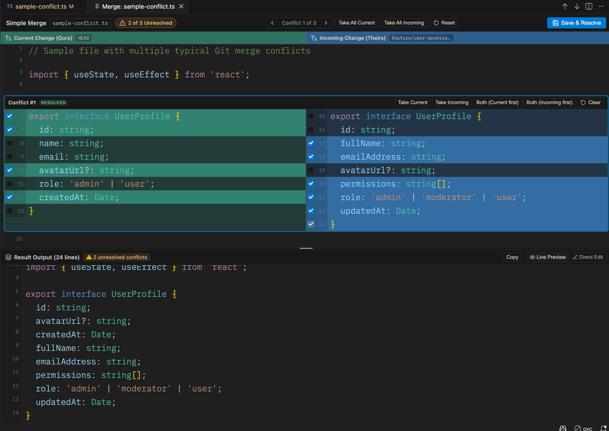

# Simple Merge View

A VS Code extension for resolving Git merge conflicts in a three-pane editor: current changes, incoming changes, and an editable result.



## Features

- Select individual lines or accept entire conflict blocks from either side.
- Combine both sides in either order.
- View word-level differences and preview the result as you make selections.
- Edit the result manually and navigate between conflicts.

## Usage

1. Open a file containing Git conflict markers.
2. Run **Open Simple Merge View** from the Command Palette, or use the conflict CodeLens, status bar entry, or editor title button.
3. Select the changes to keep, review the result, and choose **Save & Resolve**.

| Shortcut | Action |
| --- | --- |
| `Cmd+Alt+M` / `Ctrl+Alt+M` | Open the merge editor |
| `Alt+[` or `Alt+P` | Previous conflict |
| `Alt+]` or `Alt+N` | Next conflict |
| `Cmd+S` / `Ctrl+S` | Save and resolve |

## Development

Requires Node.js, npm, and VS Code 1.85 or later.

```bash
npm install
npm run build
npm test
```

Open the repository in VS Code and press `F5` to launch the Extension Development Host. Use [examples/sample-conflict.ts](examples/sample-conflict.ts) to try the editor. Run `npm run watch` to rebuild on changes.
